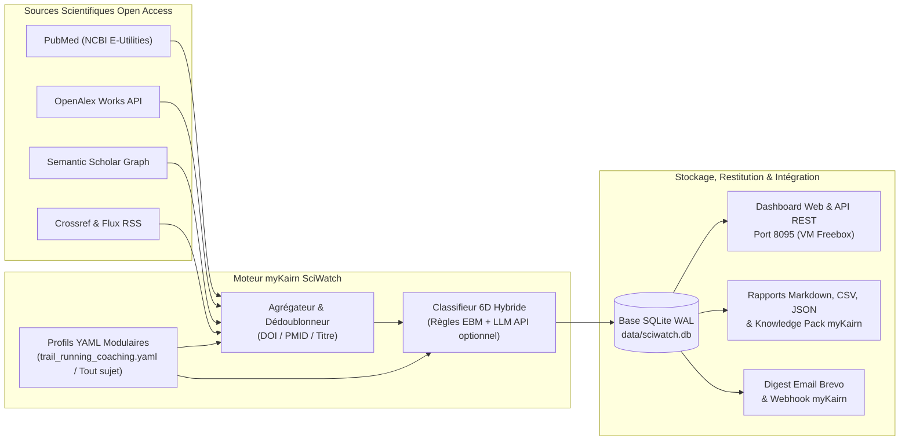

# 🔬 myKairn SciWatch — Moteur Modulaire d'Audit & de Veille Scientifique 6D

[](.github/workflows/ci.yml)
[](pyproject.toml)
[](LICENSE)
[](systemd/)

**myKairn SciWatch** est une plateforme automatisée d'audit de l'état de l'art et de veille scientifique continue. Conçue initialement pour **le coaching et l'accompagnement d'athlètes de tout niveau en trail running et ultra-endurance**, son architecture déclarative par **Profils de Sujets (`TopicProfile`)** permet d'auditer et de surveiller **n'importe quel sujet scientifique** (sciences du sport, médecine, nutrition, IA, physiologie, écologie, etc.).

Elle est optimisée pour tourner en continu avec une empreinte ultra-légère sur une **VM Freebox Delta (`192.168.1.170`, Ubuntu 24.04)** via `systemd` (Dashboard Web/API permanent + Timer de veille planifiée) ou via Docker.

---

## ✨ Fonctionnalités Principales

1. **Collecte Multi-Sources Open Access & Dédoublonnage Intelligent** :
   - **PubMed (NCBI Entrez E-Utilities)** : Recherche booléenne, résumés structurés, descripteurs MeSH, types d'études cliniques, liens PMC.
   - **OpenAlex REST API** : Couverture scientifique multidisciplinaire universelle, reconstruction intégrale des résumés (index inversé), compteurs de citations, détection Open Access / PDF, tri par impact historique (*Articles Fondateurs*).
   - **Semantic Scholar Academic Graph** : Citations influentes (`influentialCitationCount`), résumés TL;DR, domaines d'étude.
   - **Crossref & Flux RSS de Revues** : Suivi des dernières parutions des revues de référence (*Sports Medicine*, *IJSPP*, *BJSM*, *JAP*, *MSSE*, *Frontiers*, *JISSN*, etc.).
   - **Fusion Bibliographique Multi-Clés** : Dédoublonnage par DOI normalisé, PMID et empreinte alphanumérique du titre avec fusion des métadonnées.

2. **Classement & Scoring Automatisé en 6 Dimensions (Grille 6D)** :
   - **D1 — Type de publication & Pyramide EBM** : *Méta-Analyse (Niveau 1A)*, *Revue Systématique (1B)*, *Essai Contrôlé Randomisé / RCT (2A)*, *Essai Contrôlé (2B)*, *Consensus International (2C)*, *Étude de Cohorte (3A)*, *Étude Observationnelle / Terrain (3B)*, *Revue Narrative (4A)*, *Étude de Cas (4B)*.
   - **D2 — Thème & Sous-thèmes** : Classification multi-labels pondérée selon la taxonomie du profil actif.
   - **D3 — Score de Qualité Méthodologique (`/100` & Grades `A+`, `A`, `B`, `C`, `D`)** : Calculé à partir du design EBM (/35), de la taille d'échantillon `n=...` extraite automatiquement du résumé (/18), du prestige de la revue (/17), de la vélocité de citations (/18) et des marqueurs statistiques (`p-value`, `IC 95%`, `taille d'effet`) (/12).
   - **D4 — Score de Portée, Applicabilité Terrain (`/100`) & Niveau d'Athlète Cible** : Identifie le public étudié (*Tous niveaux*, *Débutant / Récréatif / Amateur*, *Compétiteur*, *Élite / Pro*, *Athlètes Féminines*, *Athlètes Masters 40+*), le cadre (*Terrain / Course réelle* vs *Laboratoire*) et la présence de métriques actionnables en coaching.
   - **D5 — Date, Fraîcheur (`/100`) & Détection d'Articles Fondateurs** : Distingue les percées récentes des classiques incontournables à fort impact bibliométrique (`🏆 Article Fondateur`).
   - **D6 — Score Global Composite (`/100`) & Synthèse Actionnable en Français** : Génère un résumé structuré en français, un **💡 Takeaway Coaching** orienté terrain, les résultats chiffrés clés et les limites méthodologiques (via moteur déterministe EBM + enrichissement LLM optionnel `Gemini Flash`, `OpenAI` ou `Anthropic`).

3. **Double Mode d'Exécution (`Audit État de l'Art` & `Veille Continue`)** :
   - `sciwatch audit` : Scan historique multi-années combinant les articles fondateurs les plus cités et les travaux récents pour dresser la cartographie complète d'un sujet.
   - `sciwatch watch` : Veille incrémentale (quotidienne ou bi-hebdomadaire via `systemd.timer`) détectant les nouvelles publications avec envoi optionnel d'un digest Email (Brevo) et synchronisation vers **myKairn Platform**.

---

## 🏗️ Architecture du Pipeline



---

## 🚀 Démarrage Rapide

### 1. Installation locale

```bash
git clone https://github.com/JReubrecht/mykairn-sciwatch.git
cd mykairn-sciwatch
cp .env.example .env
pip install -e .
```

*(Note : Le moteur fonctionne également sans installation `pip` grâce à son repli natif sur la bibliothèque standard Python 3.10+ : `PYTHONPATH=src python3 -m mykairn_sciwatch ...`)*

### 2. Lancer un Audit État de l'Art (Trail Running Coaching)

```bash
PYTHONPATH=src python3 -m mykairn_sciwatch audit --profile trail_running_coaching
```

### 3. Lancer une Veille Continue Incrémentale (30 derniers jours)

```bash
PYTHONPATH=src python3 -m mykairn_sciwatch watch --profile trail_running_coaching --days 30
```

### 4. Créer & Auditer N'IMPORTE QUEL Nouveau Sujet Scientifique

```bash
# 1. Générer automatiquement le profil YAML pour le nouveau sujet
PYTHONPATH=src python3 -m mykairn_sciwatch profile create \
  --name "Impact de la Privation de Sommeil et VFC en Ultra-Endurance" \
  --keywords "sleep deprivation, heart rate variability, ultra-endurance, cognitive fatigue" \
  --domain "sports_science" \
  --start-year 2016

# 2. Lancer l'audit de ce nouveau sujet
PYTHONPATH=src python3 -m mykairn_sciwatch audit \
  --profile impact_de_la_privation_de_sommeil_et_vfc_en_ultra_endurance
```

### 5. Démarrer le Dashboard Web & l'API REST

```bash
PYTHONPATH=src python3 -m mykairn_sciwatch serve --host 0.0.0.0 --port 8095
```

Ouvrez ensuite `http://localhost:8095` (ou `http://192.168.1.170:8095` sur le réseau local Freebox).

---

## 🖥️ Déploiement sur la VM Freebox Delta (`192.168.1.170`)

Le script `scripts/deploy_freebox_vm.py` automatise intégralement le déploiement SSH vers la VM Freebox (`freebox@192.168.1.170`), l'installation dans `/opt/mykairn-sciwatch`, la création de la commande `/usr/local/bin/sciwatch` et l'activation des services `systemd` :

```bash
# Déployer le code, activer le Dashboard Web (port 8095) + le Timer systemd, et lancer l'audit initial :
python3 scripts/deploy_freebox_vm.py --run-audit
```

### Commandes utiles sur la VM Freebox

| Action | Commande |
| :--- | :--- |
| **Dashboard Web local** | `http://192.168.1.170:8095` |
| **État du serveur Web** | `ssh freebox@192.168.1.170 "sudo systemctl status mykairn-sciwatch-web.service"` |
| **État du Timer de veille** | `ssh freebox@192.168.1.170 "sudo systemctl status mykairn-sciwatch-watch.timer"` |
| **Journaux en temps réel** | `ssh freebox@192.168.1.170 "sudo journalctl -u mykairn-sciwatch-web.service -f"` |
| **Lancer une veille manuelle** | `ssh freebox@192.168.1.170 "sciwatch watch --profile trail_running_coaching --days 14"` |

---

## 🔌 API REST & Pont myKairn Platform

Le serveur expose une API JSON sur le port `8095` :

- `GET /api/health` : État du service, nombre de profils et statut de l'enrichisseur LLM.
- `GET /api/profiles` : Liste des profils de sujets disponibles.
- `POST /api/profiles` : Génère dynamiquement un nouveau profil YAML à partir d'un titre et de mots-clés.
- `GET /api/analytics?topic=trail_running_coaching` : Statistiques 6D (KPIs, pyramide EBM, thèmes, niveaux d'athlète, chronologie, top revues).
- `GET /api/publications?topic=...&theme=...&type=...&athlete_level=...&grade=...&q=...&sort=...` : Recherche multicritères.
- `POST /api/run` : Déclenche un `audit` ou une `watch` sur un sujet (`{"topic": "trail_running_coaching", "mode": "audit"}`).
- `GET /api/export?topic=...&format=markdown|csv|json|mykairn` : Téléchargement direct des livrables et du **Knowledge Pack JSON myKairn Platform**.

---

## 🧪 Tests & Qualité

```bash
make test
```

## 📄 Licence

Distribué sous licence **MIT**. Voir [LICENSE](LICENSE).
